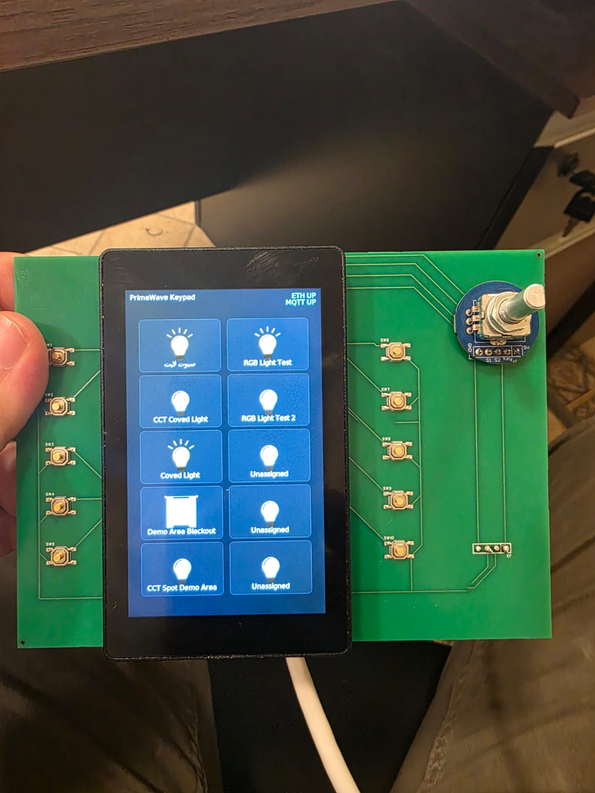
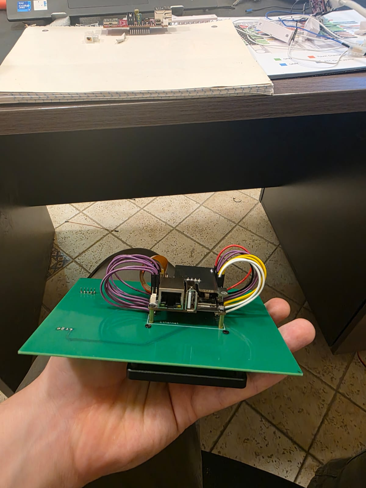
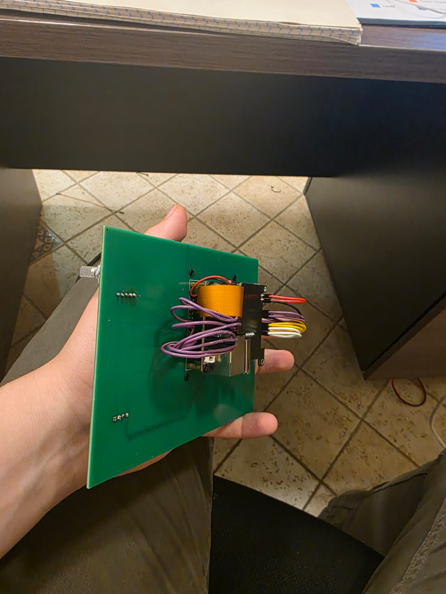

# P4 Wall Keypad

A smart wall keypad for Home Assistant, built on the ESP32-P4-NANO. It has a 4" touchscreen, 10 physical buttons, a rotary encoder and wired Ethernet, and talks to Home Assistant over MQTT. There's an optional mmWave radar for room presence.

| | | |
|---|---|---|
|  |  |  |

*Working prototype on a custom PCB I designed for this project.*

## What it does

- Each of the 10 buttons toggles a light or opens and closes a cover. Hold a button and the screen switches to a control mode where the encoder sets brightness, colour temperature, RGB hue or cover position.
- The 480×800 screen shows a live grid of tiles with each device's state. The UI works in English and Arabic.
- A built-in web page handles button setup, network settings and live control, and generates the Home Assistant YAML so setup is one paste.
- Everything goes through MQTT. The keypad never calls Home Assistant's API directly, so it keeps working through HA restarts and fits into any install.
- Wired Ethernet instead of Wi-Fi, since it lives in a wall.
- The optional LD2450 radar publishes presence over MQTT.

## Architecture

```
┌─────────────────────────────────────────────────────────────┐
│  app_main loop (main.cpp)                                    │
│  • Button debounce / short & long press                      │
│  • Encoder queue → brightness/CCT/hue/cover adjustments      │
│  • Radar presence → MQTT (retained)                          │
└──────────────┬──────────────────────────────┬───────────────┘
               │                              │
    ┌──────────▼──────────┐        ┌──────────▼──────────┐
    │  ui_keypad (LVGL)   │        │  MQTT client        │
    │  Queue → LVGL thread│◄──────►│  keypad/button/*    │
    └─────────────────────┘        │  keypad/state/#     │
               ▲                   └──────────┬──────────┘
               │                              │
    ┌──────────┴──────────┐        ┌──────────▼──────────┐
    │  Webserver.cpp      │        │  Home Assistant     │
    │  HTTP :80           │        │  (automations)      │
    └──────────┬──────────┘        └─────────────────────┘
               │
    ┌──────────▼──────────┐
    │  ethernet.c         │
    │  DHCP / static+mDNS │
    └─────────────────────┘
```

Button presses become MQTT messages and Home Assistant automations do the rest. Input is handled on its own loop and the screen runs on a separate LVGL thread, so the display never slows the buttons down.

Built with ESP-IDF (C/C++), LVGL 9, MQTT, mDNS and NVS.

## Hardware

ESP32-P4-NANO, 4" DSI touch panel (ST7701, GT911), custom keypad PCB with 10 switches and a rotary encoder, optional LD2450 mmWave radar.

## Using it

The [usage guide](USAGE_GUIDE.md) covers day-to-day use on the wall and in the browser.

## Source code

A few parts of the firmware are in [code-samples](code-samples/):

- [button_input.cpp](code-samples/button_input.cpp): debounce and short-press / long-hold detection
- [ha_state_sync.cpp](code-samples/ha_state_sync.cpp): keeping the screen in sync with Home Assistant over MQTT, including after an HA restart
- [ethernet.c](code-samples/ethernet.c): wired networking with DHCP, static IP fallback and mDNS

The full source code is available on request. Reach me on [LinkedIn](https://www.linkedin.com/in/basel-yasar-b5522b260).

## About

I designed the system architecture, the custom PCB (schematic and layout) and the hardware integration, and led the firmware development. I built it during my work at an IoT company and published this with their permission.
